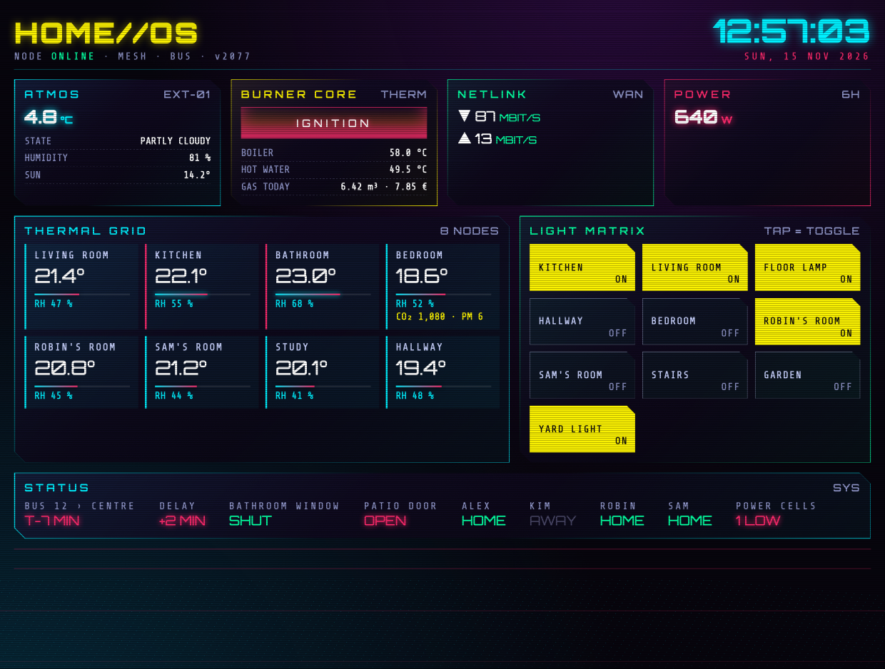
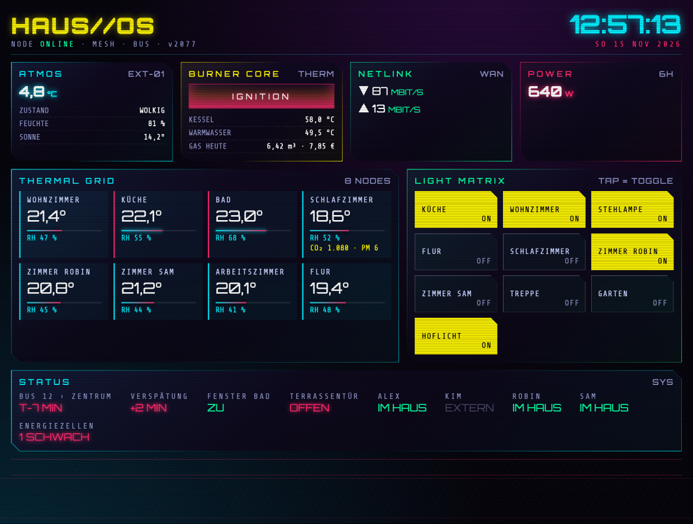

# Cyberpunk



Neon HUD with scanlines, a glitching logo and a grid floor.

- Tiles for outdoor readings, heating, internet throughput and house power with a six-hour sparkline.
- Rooms with temperature and humidity, lights as neon buttons.
- Ads for made-up corporations get slapped across the screen at an angle. Tap one to make it go away.
- Status bar with next departure, contacts, people and low batteries, plus a news ticker.

## Ads

```yaml
ads: false        # switch ads off completely (default: on)
ad_interval: 40   # seconds between two ads, at least 10
ad_duration: 9    # seconds an ad stays up
```

## Configuration

All cards share the same keys. Anything missing is hidden or shown as "–".

```yaml
type: custom:cyberpunk-card
title: Home
language: en                          # any language with a file in i18n/; defaults to the Home Assistant language
outside_temperature: sensor.outdoor_temperature
outside_humidity: sensor.outdoor_humidity
weather: weather.forecast_home        # condition, and fallback for the outdoor temperature
flame: binary_sensor.burner_flame     # heating, optional
boiler: sensor.boiler_temperature
hot_water: sensor.hot_water_temperature
gas_today: sensor.gas_today
gas_cost: sensor.gas_cost_today
power: sensor.house_power             # W
download: sensor.wan_download         # optional, converted to Mbit/s whatever the unit
upload: sensor.wan_upload
battery_threshold: 20                 # battery sensors below this are reported
idle_timeout: 300                     # idle screen after this many seconds without touch (omit = off)
idle_wake:                            # optional, keeps the dashboard awake while active
  - binary_sensor.kitchen_presence
rooms:
  - name: Living room
    temperature: sensor.living_room_temperature
    humidity: sensor.living_room_humidity
    co2: sensor.living_room_co2           # optional, ppm; yellow from 1000, red from 1200
    pm25: sensor.living_room_pm25         # optional, µg/m³; yellow from 15, red from 35
lights:
  - name: Kitchen
    entity: light.kitchen
departure:                            # optional, sensor holding the timestamp of the next departure
  name: Bus 12 › Centre
  entity: sensor.next_departure
  delay: sensor.delay
contacts:                             # optional, windows and doors
  - name: Bathroom window
    entity: binary_sensor.bathroom_window
```

The idle screen puts a black layer with a faint clock over the dashboard; a tap wakes it without switching anything underneath. A browser cannot dim the tablet's backlight itself. While idle, all animations pause and the card redraws only every 30 seconds, which helps older tablets.

People come from all `person.*` entities, low batteries from all sensors with `device_class: battery`.

The cards speak English and German. Without `language` they follow the Home Assistant language; languages without a translation fall back to English.

## Translations

All texts live in `i18n/<language>.json`, one file per language, keyed by short names such as `boiler` or `departs_in`. Placeholders in braces (`{mins}`, `{name}`) are filled in by the card and may move freely within the sentence. To add a language, copy `i18n/en.json` to e.g. `i18n/fr.json`, translate the values and open a pull request. Missing keys fall back to English.

## Installation

Via HACS as a custom repository (type Dashboard), or by hand: copy `cyberpunk-card.js` to `/config/www/` and add `/local/cyberpunk-card.js` as a JavaScript module under Settings → Dashboards → Resources.

A discreet signature sits in the bottom right corner; `signature: false` hides it.

The card is meant for a panel view (`panel: true`) so it fills the screen.

```yaml
views:
  - title: Home
    panel: true
    cards:
      - type: custom:cyberpunk-card
        # configuration as above
```

The fonts are embedded in the card file; the card loads nothing from external servers.

## License

Apache License 2.0, copyright 2026 Axel Eble. If you redistribute or modify the card, include `LICENSE` and `NOTICE`.


---

## Deutsch

### Cyberpunk



Neon-HUD mit Scanlines, Glitch-Logo und Rasterboden.

- Kacheln für Außenwerte, Heizung, Internetdurchsatz und Hausleistung mit Verlauf der letzten 6 Stunden.
- Räume mit Temperatur und Feuchte, Lichtschalter als Neon-Tasten.
- Werbeschilder erfundener Konzerne, die schräg über die Anzeige geklatscht werden. Antippen schließt ein Schild sofort.
- Statuszeile mit Abfahrt, Kontakten, Personen und schwachen Batterien, dazu ein Laufband.

#### Werbung

```yaml
ads: false        # Werbung ganz abschalten (Standard: an)
ad_interval: 40   # Sekunden zwischen zwei Schildern, mindestens 10
ad_duration: 9    # Sekunden, die ein Schild stehen bleibt
```
#### Konfiguration

Alle Karten teilen sich dieselben Schlüssel. Was fehlt, wird ausgeblendet oder als „–“ angezeigt.

```yaml
type: custom:cyberpunk-card
title: Haus
language: de                          # jede Sprache mit Datei in i18n/; Standard ist die Sprache von Home Assistant
outside_temperature: sensor.aussen_temperatur
outside_humidity: sensor.aussen_feuchte
weather: weather.forecast_home        # Zustand und Ersatz für die Außentemperatur
flame: binary_sensor.brenner_flamme   # Heizung, optional
boiler: sensor.kesseltemperatur
hot_water: sensor.warmwassertemperatur
gas_today: sensor.gas_heute
gas_cost: sensor.gaskosten_heute
power: sensor.hausleistung            # W
download: sensor.wan_download         # optional, Einheit wird nach Mbit/s umgerechnet
upload: sensor.wan_upload
battery_threshold: 20                 # Batteriesensoren darunter werden gemeldet
idle_timeout: 300                     # Ruhemodus nach so vielen Sekunden ohne Berührung (weglassen = aus)
idle_wake:                            # optional, hält das Dashboard wach, solange aktiv
  - binary_sensor.kueche_praesenz
rooms:
  - name: Wohnzimmer
    temperature: sensor.wohnzimmer_temperatur
    humidity: sensor.wohnzimmer_feuchte
    co2: sensor.wohnzimmer_co2            # optional, ppm; gelb ab 1000, rot ab 1200
    pm25: sensor.wohnzimmer_pm25          # optional, µg/m³; gelb ab 15, rot ab 35
lights:
  - name: Küche
    entity: light.kueche
departure:                            # optional, Sensor mit Zeitstempel der nächsten Abfahrt
  name: Linie 3 › Stadt
  entity: sensor.naechste_abfahrt
  delay: sensor.verspaetung
contacts:                             # optional, Fenster und Türen
  - name: Fenster Bad
    entity: binary_sensor.fenster_bad
```

Der Ruhemodus legt ein schwarzes Bild mit schwacher Uhr über das Dashboard; Antippen weckt es, ohne darunter etwas zu schalten. Die Helligkeit des Tablets selbst lässt sich aus dem Browser nicht steuern. Solange er aktiv ist, stehen alle Animationen still und die Karte zeichnet nur alle 30 Sekunden neu; das entlastet ältere Tablets.

Die Karten sprechen Deutsch und Englisch. Ohne `language` folgen sie der Sprache von Home Assistant; Sprachen ohne Übersetzung erscheinen auf Englisch.

Alle Texte stehen in `i18n/<sprache>.json`, eine Datei je Sprache, mit kurzen Schlüsseln wie `boiler` oder `departs_in`. Platzhalter in geschweiften Klammern (`{mins}`, `{name}`) füllt die Karte; sie dürfen im Satz beliebig stehen. Für eine neue Sprache `i18n/en.json` kopieren, etwa nach `i18n/fr.json`, die Werte übersetzen und einen Pull Request stellen. Fehlende Schlüssel fallen auf Englisch zurück.

Personen kommen automatisch aus allen `person.*`-Entitäten, schwache Batterien aus allen Sensoren mit `device_class: battery`.

#### Einbau

Über HACS als benutzerdefiniertes Repository (Typ Dashboard) oder von Hand: `cyberpunk-card.js` nach `/config/www/` kopieren und unter Einstellungen → Dashboards → Ressourcen als JavaScript-Modul `/local/cyberpunk-card.js` eintragen.

Unten rechts steht eine dezente Signatur; `signature: false` blendet sie aus.

Die Karte ist für eine Panel-Ansicht gedacht (`panel: true`), damit sie den ganzen Bildschirm füllt.

```yaml
views:
  - title: Haus
    panel: true
    cards:
      - type: custom:cyberpunk-card
        # Konfiguration wie oben
```

Die Schriften stecken in der Kartendatei; die Karte lädt nichts von fremden Servern.

#### Lizenz

Apache License 2.0, Copyright 2026 Axel Eble. Wer die Karte weitergibt oder verändert, liefert `LICENSE` und `NOTICE` mit.